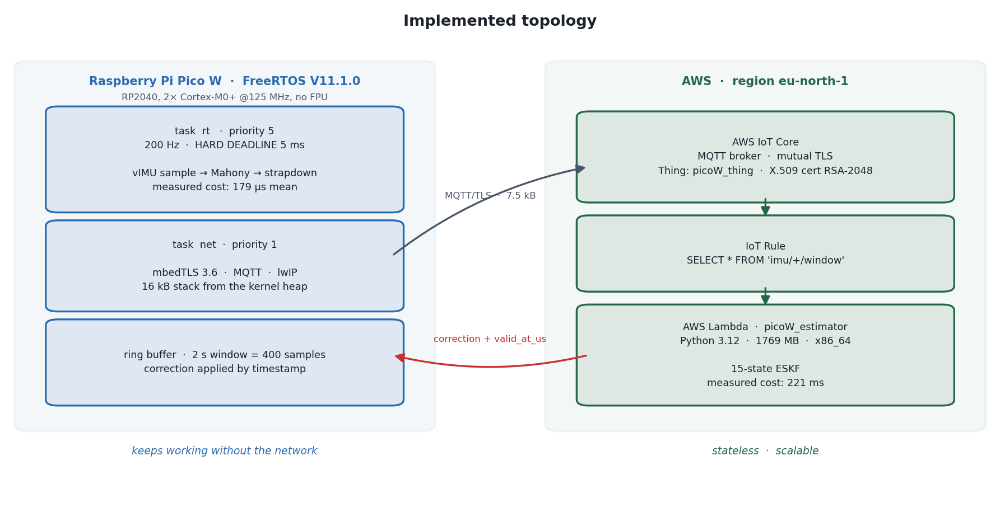
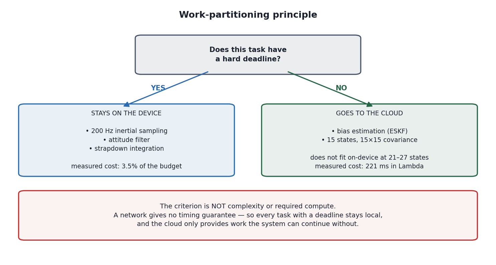
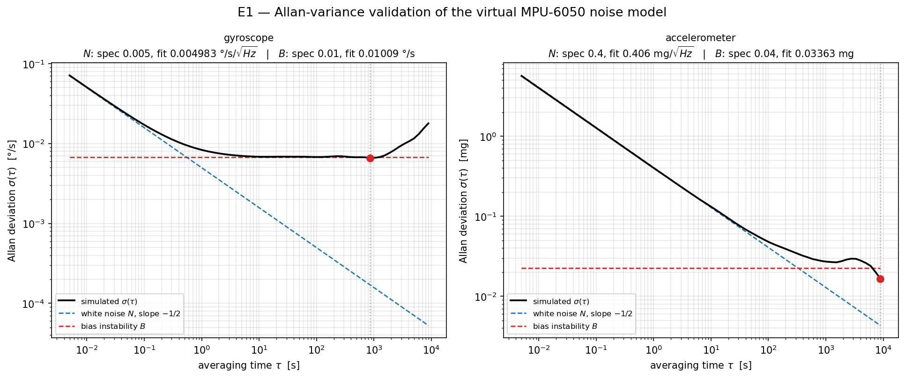
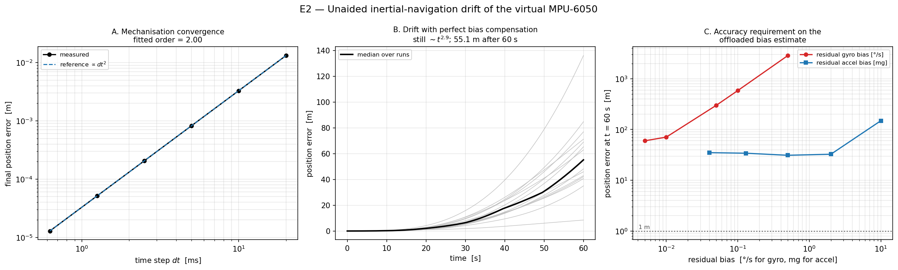
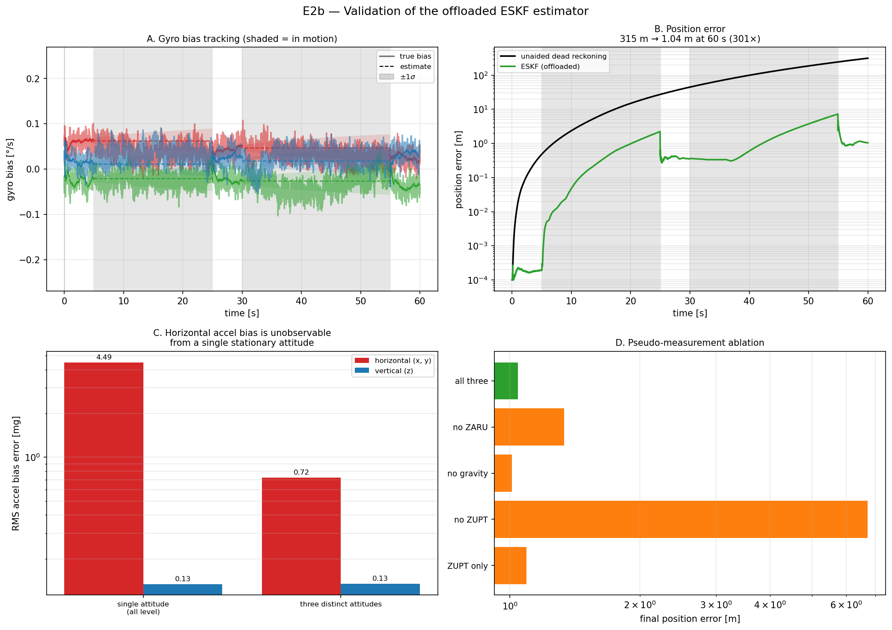
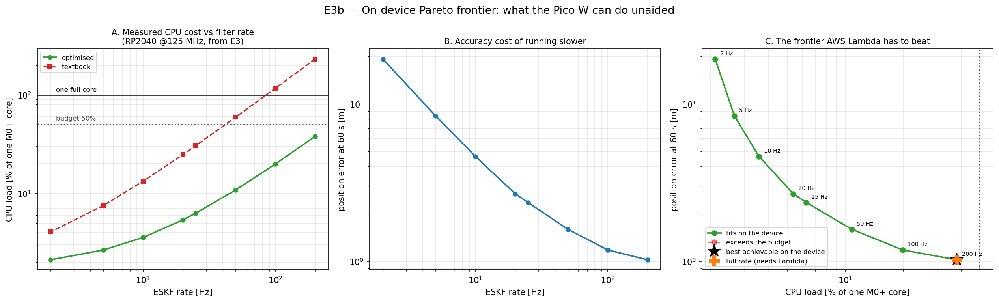
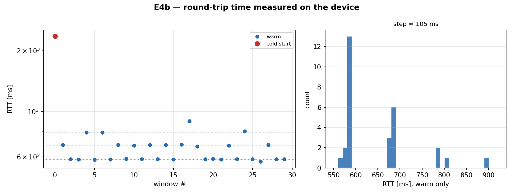
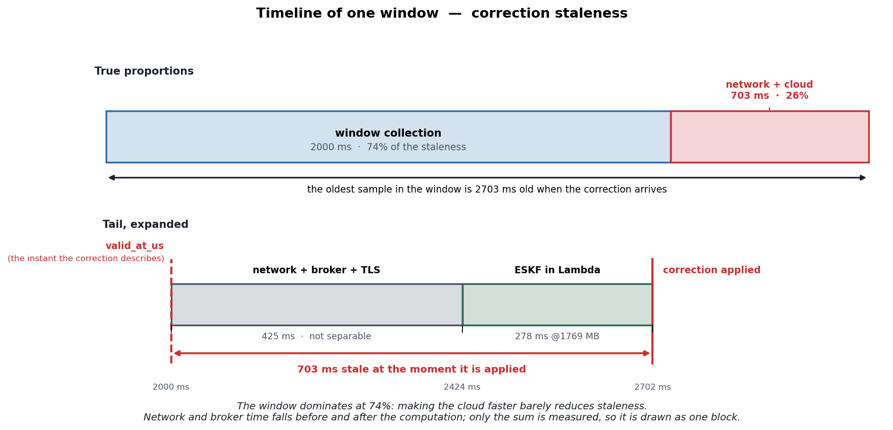
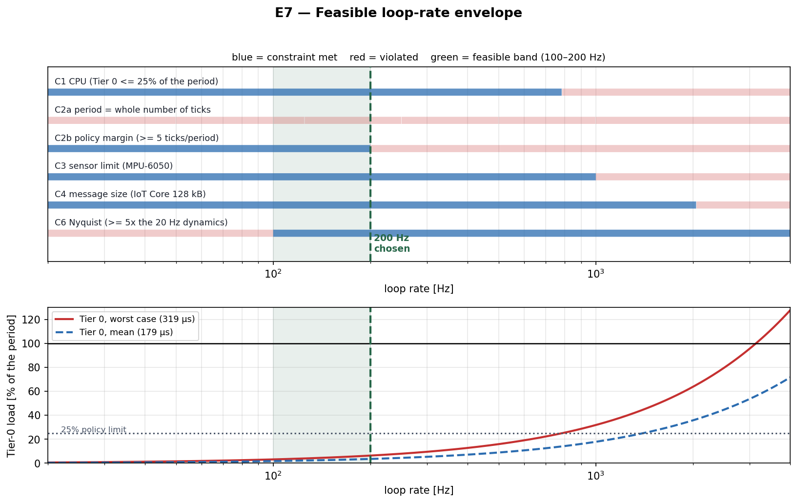

# Offloading State Estimation from an RTOS Node to AWS Lambda

*Measured on a Raspberry Pi Pico W: what it costs, how late the corrections
arrive, and why that makes it an out-of-sequence measurement problem.*

Bachelor's thesis testbed. Characterises the feasibility envelope of offloading
inertial state estimation from a hard-real-time RTOS node (Raspberry Pi Pico W,
FreeRTOS) to serverless FaaS (AWS Lambda), and treats FaaS tail latency as an
out-of-sequence measurement (OOSM) problem.

**Thesis claim.** Offloading estimation to serverless introduces corrections that
arrive late and out of order. Naive fusion of those corrections degrades accuracy
sharply beyond a delay threshold; OOSM-aware fusion (rewind and re-propagate)
holds accuracy to much larger delays. That threshold is the headline result.

The partitioning rule is deliberately not "heavy work goes to the cloud". A
network gives no timing guarantee, so anything with a deadline stays on the
device, and the cloud only does work the node can survive without:

## Status

| Exp | Description | Where | State |
|-----|-------------|-------|-------|
| E1 | Allan-variance validation of the virtual MPU-6050 | host | **PASS** |
| E2 | Unaided dead-reckoning drift + bias requirement curve | host | **PASS** |
| E2b | ESKF estimator validation (the offloaded payload) | host | **PASS** |
| E3 | Cortex-M0+ compute profile (no FPU) | Pico W | **measured** |
| E3b | ESKF rate vs accuracy: the on-device Pareto frontier | host + E3 data | **done** |
| L | Lambda handler + wire contract, validated offline | host | **PASS** |
| E4a | Pico W -> AWS IoT Core, mutual TLS | Pico W + AWS | **measured** |
| E4b | Device-measured round trip through IoT Core and Lambda | Pico W + AWS | **measured** |
| E4c | Cloud-side latency breakdown, warm vs cold | AWS | **measured** |
| E5 | FreeRTOS hard deadline under TLS crypto load | Pico W | **measured** |
| E7 | Feasible loop-rate envelope from measured constraints | analysis | **done** |
| -- | Naive vs OOSM-aware fusion (the novel contribution) | | planned |
| -- | Tier comparison: native / Greengrass-local / cloud | | planned |
| -- | Cloud failure injection, graceful degradation | | planned |

Raw captures from the board and from AWS are in [`docs/`](docs/); see
[`docs/README.md`](docs/README.md) for what each file is.

## Results so far

### E1 - the virtual sensor is defensible

The noise model is specified from the InvenSense MPU-6050 datasheet, then a long
stationary record is synthesised and its Allan variance computed *blind*. The
five-term Allan model is fitted and compared against the specification it came from.
The whole procedure is repeated over ten independent seeds, because a single
realisation is a draw, not a property of the model.

| | N (noise density) | B (bias instability) |
|---|---|---|
| Gyroscope | 0.83% ± 0.60 (0.34–2.39) | 2.35% ± 2.07 (0.51–7.96) |
| Accelerometer | 1.55% ± 1.47 (0.02–4.20) | 20.27% ± 18.40 (0.26–54.72) |

Mean +/- sd (min–max) of the error against specification, over seeds
20260822–20260831:

    for s in $(seq 20260822 20260831); do python e1_allan_validation.py --seed $s --no-plot; done

N is recovered within 4.2% on every seed, for both sensors. The accelerometer's
B is not: it ranges from 0.26% to 54.72%, and **3 of the 10 seeds fail the
25% gate** (the default seed passes). Six hours is not enough to pin it down,
so the claims here rest on N, which is recovered reliably.

This rests on a closed-form identity derived in `noise_model.py`: pink-filtering
white noise of standard deviation `sigma_w` produces bias instability `B = sigma_w`
exactly. The E1 run verifies that numerically rather than assuming it.

Methodological finding: the accelerometer's white/flicker crossover sits at
`tau = (N / 0.6643 B)^2` ~= 227 s, so its bias instability **cannot be resolved
without a multi-hour static record**. The default run is 6 h for this reason.

### E2 - unaided inertial navigation is hopeless, quantifiably

- **Mechanisation verified**: error ratio exactly 4.00 per halving of `dt`,
  fitted order of convergence 2.000. All subsequent drift is attributable to the
  sensor model, not to an integration bug.
- **Drift floor**: 55.1 m median after 60 s with *perfect* bias compensation
  (p10-p90: 37-82 m over 15 runs), ~ t^2.86.
- **Physics self-confirms**: the fitted drift exponent tends to 2.97 as gyro bias
  dominates (tilt-induced gravity leakage, t^3) and to 1.93 as accelerometer bias
  dominates (direct double integration, t^2).
- **Design conclusion**: gyro bias is the binding constraint. At the 0.01 deg/s
  bias-instability floor it doubles the 60 s error (35.4 m -> 70.8 m), and at
  0.1 deg/s it reaches 586 m, while accelerometer bias at 0.13 mg leaves it
  essentially unchanged (35.4 -> 34.1 m). The offloaded estimator should
  prioritise gyro bias.

### E2b - the offloaded estimator works, and needs the right conditions

The ESKF is the payload that will run in Lambda, so it is validated on the host
before any systems work depends on it. Scored against the bias the noise model
*actually injected* (turn-on + flicker + rate random walk), not just the constant
part -- scoring against the constant alone makes a correct filter look broken,
because flicker dominates at long horizons.

| Horizon | Dead reckoning | ESKF | Factor |
|---------|---------------|------|--------|
| 10 s | 2.36 m | 0.05 m | 49x |
| 30 s | 44.83 m | 0.36 m | 126x |
| 60 s | 315 m | 1.04 m | 301x |

Attitude error at 60 s: 3.15 deg -> 0.27 deg. Filter covariance is consistent
(|error|/sigma = 1.15 gyro, 0.77 accel). Stationary detector precision 0.988,
recall 0.987.

**Observability requires attitude diversity at rest.** A gravity update measures
`h = R^T g + b_a`, in which a tilt about x and a bias on y are indistinguishable.
Resting always at the same attitude therefore leaves horizontal accelerometer
bias permanently unobservable:

| Rest attitudes | accel bias err, xy | accel bias err, z |
|----------------|--------------------|-------------------|
| single (all level) | 4.49 mg | 0.134 mg |
| three distinct | 0.72 mg | 0.134 mg |

The vertical axis is unchanged because tilt affects it only to second order --
it was already observable. This is classical multi-position IMU calibration,
applied opportunistically rather than on a rate table.

**Ablation tells the firmware author what is droppable.** Final position error,
attitude error and gyro bias error with each pseudo-measurement removed:

| Enabled | pos [m] | att [deg] | gyro bias [deg/s] |
|---------|---------|-----------|-------------------|
| all three | 1.04 | 0.274 | 0.0212 |
| no ZARU | 1.34 | **1.878** | **0.0478** |
| no gravity | 1.01 | 0.326 | 0.0211 |
| no ZUPT | **6.73** | 0.267 | 0.0212 |
| ZUPT only | 1.09 | 0.971 | 0.0413 |

ZUPT carries position (6.5x worse without it), ZARU carries attitude and gyro
bias (7x and 2.3x worse without it), and the gravity update is very nearly
redundant once the other two are present. Under deadline pressure, drop gravity.

**What is not claimed.** The ESKF does not make position observable; nothing in
an IMU-only architecture can. Error is reset at each stationary phase, so it is
bounded by the *coast interval between stationary phases*, not by mission time.
Fitting a drift exponent to the ESKF error is meaningless -- the signal is a
sawtooth, not a power law.

### E3 - measured on the actual Pico W

Real hardware, not an estimate: RP2040 at 125 MHz, timed with SysTick at
single-cycle resolution, built at -O2, minimum over repeated trials. Budget is
5 ms per sample at 200 Hz. Raw capture in `docs/e3_results.txt`.

The RP2040 has no FPU. It is not pure softfloat either -- the bootrom carries
optimised single-precision routines that the SDK links by default -- so these
are the *best* case for the part:

| operation | cycles |
|-----------|--------|
| float add | 83 |
| float multiply | 69 |
| float divide | 164 |
| float sinf | 669 |
| double add | 108 |
| double multiply | 185 |

**Tier 0 fits comfortably.** Mahony attitude update 10,992 cycles (87.9 us,
1.75% of budget); strapdown INS step 10,940 cycles (1.75%). Both together
consume 3.5% of the sample period, so the hard-real-time loop stays on-device
with room to spare.

**The ESKF does not fit.**

| operation | cycles | us | % of 5 ms budget |
|-----------|--------|-----|------------------|
| 15x15 matmul (3375 MAC) | 527,245 | 4,218 | 84.4% |
| predict, dense (textbook) | 1,058,777 | 8,470 | **169.4%** |
| predict, sparse (block) | 155,942 | 1,248 | 25.0% |
| update3, Joseph | 1,521,245 | 12,170 | **243.4%** |
| update3, short form | 282,507 | 2,260 | 45.2% |

A textbook ESKF at 200 Hz costs **413% of the entire sample period** -- it
needs 20.6 ms of compute per 5 ms of wall clock, so it cannot run at all.
Hand-optimised (sparse predict + short-form update) it still costs 70%, leaving
under a third of the core for the sensor driver, the lwIP/mbedTLS stack that
the offload itself depends on, and scheduling slack.

**The optimisation gap is itself a result**: exploiting the block sparsity of F
gives 6.8x on predict, and dropping Joseph for the short form gives 5.4x. A
naive port is nearly 7x off what the same algorithm can achieve on this part.

*Verification.* The sparse predict was checked against the dense one before
being timed: max relative difference 234 ppb, i.e. float rounding. And the
measurements are internally consistent -- one float add plus one float multiply
is 152 cycles, so 3375 MACs predicts 513,000 cycles against 527,245 measured
(2.7% loop overhead), and dense predict comes out at exactly 2x a matmul
(ratio 1.004). The numbers corroborate each other rather than standing alone.

**State dimension is where the wall actually is.** Covariance propagation is
O(n^3). Measured on the board, dense n x n multiply:

| state dim | cycles | predict (2x) | % of 5 ms budget | what it buys |
|-----------|--------|--------------|------------------|--------------|
| 15 | 527,245 | 1,054,486 | 169% | pose, velocity, biases |
| 21 | 1,445,127 | 2,890,254 | 463% | + scale factors |
| 27 | 3,072,402 | 6,144,804 | 983% | + misalignment |
| 33 | 5,605,833 | 11,211,666 | 1794% | + second IMU |
| 39 | 9,251,470 | 18,502,940 | 2960% | + magnetometer |

The n^3 law holds to within 0.2% over the whole range (ratios 0.998-1.000
against the n=15 point), so this is a measured property of the hardware rather
than a flop-count argument.

Even granting the *optimistic* assumption that block sparsity keeps paying its
n=15 factor of 6.8x at every size -- it will not, because the added states
couple into velocity and attitude and make F denser -- the boundary at 200 Hz
lands between 21 and 27 states:

| state dim | optimistic sparse cost | % budget | verdict |
|-----------|------------------------|----------|---------|
| 15 | 155,942 (measured) | 25% | fits |
| 21 | ~425,000 | 68% | tight |
| 27 | ~901,000 | 144% | does not fit |

This closes the loop with E1. The noise model includes scale-factor (+/-3%) and
cross-axis (+/-2%) errors, straight off the datasheet. A 15-state filter cannot
estimate those and simply eats the residual; estimating them needs 21-27 states,
which does not fit on the device. That is a measured, non-circular reason to
offload.

### E3b - the on-device frontier, and an honest correction

E3b sweeps ESKF rate against accuracy, pairing each rate with its measured CPU
cost. It produced a result that contradicts the obvious framing of the thesis,
and the correction matters:

| ESKF Hz | CPU (optimised) | CPU (textbook) | pos err at 60 s |
|---------|-----------------|----------------|-----------------|
| 200 | 38.0% | 232.0% | 1.02 m |
| 100 | 19.9% | 116.9% | 1.18 m |
| 50 | 10.8% | 59.3% | 1.60 m |
| 20 | 5.4% | 24.8% | 2.68 m |
| 10 | 3.6% | 13.3% | 4.64 m |
| 2 | 2.1% | 4.1% | 19.31 m |

**A hand-optimised 15-state ESKF at the full 200 Hz fits on the Pico W, at 38%
of one core.** Raw compute infeasibility is therefore *not* a valid reason to
offload, and any thesis that claims it is will not survive the question "why not
just optimise it?".

What survives, and what the thesis should actually argue:

1. **State dimension.** 15 states fit; the 21-27 states needed to estimate the
   scale-factor and misalignment errors that the datasheet says are present do
   not. This is the strongest compute argument and it is measured.
2. **Implementation burden.** The textbook form costs 232% and does not run. The
   6.8x needed to make it fit is hand-written block-sparse linear algebra on a
   part with no FPU. Offloading buys back that engineering cost -- a systems
   argument, not a performance one.
3. **Headroom.** 38% is before the CYW43 driver, lwIP and mbedTLS, which the
   offload path needs anyway and which are not free.
4. **The OOSM contribution is unaffected.** Whatever is offloaded and for
   whatever reason, tail latency makes corrections arrive out of order. E7
   stands on its own.

The thesis question is therefore not "can the device do it" but "where is the
placement boundary, and how do you make the cloud side work despite tail
latency" -- which is what "integration of AWS Lambda into IoT RTOS devices"
should mean.

### Lambda handler - the AWS integration, validated before deployment

`cloud/lambda/estimator/` holds the offloaded function and its wire contract.
`test_local.py` drives it through 30 sequential 2 s windows with no AWS
involved: 16 checks, all passing. Deploying against a validated handler means a
later failure is an AWS failure (IAM, layer, message size, timeout) and not an
algorithm failure.

Two architectural findings came out of writing it, both before spending
anything on AWS:

**1. The covariance must travel over the wire.** Lambda is stateless, and a
short window frequently contains no stationary interval, so the filter has
nothing to observe bias against unless the prior arrives with the request.
Measured on a window with zero stationary samples:

| | gyro bias error |
|---|---|
| without carried state | 0.0350 deg/s |
| with carried state | 0.0217 deg/s |

Packed as a float32 upper triangle, P is 640 base64 characters -- 8.4% of a
7.5 kB window. Cheap, but it is a real consequence of choosing FaaS over a
long-lived service.

**2. Corrections are stale before they leave the cloud.** Filter compute alone
measures ~120 ms median and up to ~358 ms per 2 s window on the development PC
(221-278 ms once deployed, see E4b/E4c), and the window's own
span adds seconds on top. So a correction is already badly out of date
independent of any network delay. This is why `valid_at_us` stamps the time the
correction applies to, and it means out-of-sequence handling on the device is
mandatory rather than an optimisation -- which is precisely the E7 contribution.

Sizing: a 2 s / 400-sample window is 7.5 kB of JSON against the AWS IoT Core
128 kB ceiling. A 60 s window would be 187.7 kB and would be rejected outright.

### E4a - mutual TLS from the Pico W to AWS IoT Core

Measured on the board, against the real endpoint. AWS accepted the device
certificate, so WiFi, SNTP, DNS, X.509 and mutual TLS all work end to end.
Raw capture in `docs/e4_results.txt`.

| stage | ms |
|-------|-----|
| WiFi associate + DHCP | 5186.1 |
| SNTP time sync | 272.8 |
| DNS resolve | 36.6 |
| plain TCP connect | 64.6 |
| parse PEM + build TLS config | 19.8 |
| TCP + TLS connect | 6201.2 |
| **TLS handshake alone** | **6136.6** |

**The handshake is 6.1 seconds, and 98% of it is arithmetic, not network.**
Connecting plain TCP to the same host takes 64.6 ms, which is one round trip to
Stockholm. A TLS 1.2 handshake adds about two more, so roughly 129 ms of the
6137 ms is network. The remaining **6007 ms is the RP2040 computing** -- chiefly
the RSA-2048 private-key operation for client authentication, on a 125 MHz
Cortex-M0+ with no crypto accelerator.

Consequences that shape the rest of the design:

1. **The connection must be long-lived.** Six seconds per handshake means
   reconnecting per message is impossible. The MQTT session has to be
   established once and held open, which in turn makes the device's reconnect
   policy a real design question rather than an afterthought.
2. **Security dominates the connection budget, not the payload.** The whole
   ESKF window is 7.5 kB and the estimator runs in ~120 ms; the handshake that
   protects it costs 50x that.
3. **It sets up the RSA vs ECDSA comparison.** AWS's one-click flow issues
   RSA-2048. A P-256 certificate would cut the private-key operation
   substantially, and measuring both on this hardware is a clean, self-contained
   result for the thesis.

Note that certificate *parsing* is cheap -- 19.8 ms for all three PEM files.
The expense is entirely in the handshake's private-key operation, not in
handling the credentials.

*Four real bugs were found getting here*, each worth recording because each
produced a symptom that pointed somewhere other than its cause:

| symptom | actual cause |
|---------|--------------|
| CMake could not build pioasm | needs a host compiler; the extension ships a prebuilt one |
| `unknown type name 'uint32_t'` | lwipopts.h is included before any type exists |
| `gmtime` type mismatch, then "No mbedtls_ms_time available" | overriding `MBEDTLS_PLATFORM_TIME_TYPE_MACRO` breaks `gmtime`; mbedTLS 3.6 also needs a monotonic ms clock the SDK does not supply |
| `*** PANIC *** pool MEMP_SYS_TIMEOUT is empty`, raised by **TCP** | **SNTP** exhausted the pool: lwIP sizes `MEMP_NUM_SYS_TIMEOUT` from its internal modules only, and apps like SNTP are not counted |

The last one is the instructive one: the panic named TCP, the fault was SNTP,
and the fix was a single `#define`.

### E4b - the round trip, measured on the device

The Pico publishes a real 2 s / 400-sample vIMU window (baked into flash by
`firmware/tools/gen_window.py`) over the long-lived MQTT/TLS session; an IoT
Rule invokes the Lambda, which publishes the correction back. The round trip is
timed on the device with a single clock (`time_us_64`), so no clock
synchronisation is involved. 30 windows, all 30 answered, none stale.
Raw capture in `docs/e4b_results.txt`.

| | ms |
|---|---|
| min | 566.6 |
| p50 | 585.6 |
| mean | 702.7 |
| p90 | 788.4 |
| max (the one cold start) | 2356.4 |

| breakdown (means) | ms | share |
|---|---|---|
| ESKF in Lambda | 277.6 | 39.5% |
| remainder: network + broker + TLS + rule dispatch | 424.7 | 60.4% |

The remainder is not "the network": it includes TLS on both ends, the broker,
rule dispatch and the return publish. It is reported as a remainder because that
is what one clock can measure honestly.

**Cold start costs 1.7 s.** 1 of 30 invocations was cold; mean warm RTT was
645.7 ms against 2356.4 ms cold.

**The round trip is quantised, not continuous.** Warm RTTs fall into narrow
clusters (566-585, 674-687, 788-801, 897 ms) spaced 105.3 +/- 3.5 ms apart, while
Lambda compute is the same in every cluster (275-282 ms). The step is therefore
network round trips, not cloud load -- about 1.8x a 58 ms ICMP round trip to the
region. A quantised delay is predictable in a way a continuous one is not, which
matters for the OOSM design. Analysis in `docs/e4b_analysis.txt`
(`vimu-gen/e4b_analyse.py`).

**Staleness is dominated by the window, not the cloud.** By the time a
correction is applied, the oldest sample it describes is 2.7 s old, and 74% of
that is the 2 s window itself. Making the cloud faster cannot fix this; handling
out-of-sequence corrections on the device is mandatory.

### E4c - what CloudWatch does not show

`cloud/lambda/estimator/e4c_return_leg.py` publishes windows from the PC onto
the same rule-driven path and reads the handler's own timing out of the logs,
in two regimes: sequential (one per second, one warm environment) and burst
(all at once, forcing Lambda to scale out). Capture in
`docs/e4c_results_lazy.txt`.

| | sequential | burst |
|---|---|---|
| invocations | 10 (0 cold) | 10 (8 cold) |
| distinct environments | 1 | 9 |
| ESKF compute, median | 259.7 ms | 264.8 ms |
| return publish, warm, median | 9.0 ms | 10.3 ms |
| return publish, cold, median | -- | 456.7 ms |

**CloudWatch underestimates the cold start by half.** Reported `Init Duration`
averages 501 ms, but the first publish from a fresh environment costs a further
490 ms, because boto3 builds its client, resolves credentials and opens TLS to
`iot-data` lazily on the first call -- after init has ended. The true cold-start
cost is ~991 ms, and 49% of it is invisible in both `Init Duration` and the
`Duration` of every later invocation.

### E5 - the hard deadline survives TLS crypto on FreeRTOS

E4a showed the TLS handshake is 6 s of CPU-bound RSA arithmetic, and bare metal
it blocks everything. E5 runs the 200 Hz Tier-0 loop (vIMU -> Mahony ->
strapdown) as a priority-5 FreeRTOS task against a priority-1 task doing
back-to-back RSA-2048 private-key operations with the real device key, using
the cyclictest method. Raw capture in `docs/e5_results.txt`.

| phase | samples | max latency | period deviation | deadline misses |
|---|---|---|---|---|
| A baseline (RT alone) | 2,799 | 0 us | -1 / +2 us | 0 |
| B contention (RT + RSA) | 11,799 | 10 us | -22 / +22 us | 0 |
| C recovery (RT alone) | 2,799 | 0 us | 0 / +1 us | 0 |

17 RSA operations completed during phase B (mean 3.6 s each), so the load was
real. Tier-0 work cost a mean of 179 us and at worst 319 us of the 5000 us
period. **Preemption protects the real-time loop completely**: the security cost
that makes bare metal unusable is absorbed by the scheduler.

### E7 - deriving the loop rate instead of asserting it

200 Hz was used throughout before it was justified. E7 computes the band of
rates allowed by constraints that are each measured or published -- Tier-0 CPU
cost (E5 worst case), FreeRTOS tick granularity, the MPU-6050 output limit, the
IoT Core 128 kB message cap and a Nyquist margin over the tracked dynamics.

| constraint | allowed |
|---|---|
| C1 Tier-0 CPU <= 25% of period | <= 784 Hz |
| C2a period is a whole number of 1 kHz ticks | 1000/N Hz |
| C2b policy margin, >= 5 ticks per period | <= 200 Hz |
| C3 MPU-6050 output rate | <= 1000 Hz |
| C4 IoT Core message size, 2 s window | <= 2046 Hz |
| C6 Nyquist, >= 5x 20 Hz dynamics | >= 100 Hz |

The feasible band is **100-200 Hz** and 200 Hz sits at its top. Integration
error is not a constraint: even 50 Hz gives 1.3 cm over 30 s, against metres of
sensor-driven drift. The upper edge is set by a stated policy margin (C2b), not
by a hardware limit -- CPU would allow ~780 Hz.

## Layout

    vimu-gen/                 virtual IMU, estimator and the host-side experiments
      noise_model.py            MPU-6050 error model, datasheet-cited
      allan.py                  overlapping Allan variance + five-term model fit
      rotations.py              quaternion / Euler / DCM utilities (ENU, scalar-first)
      trajectory.py             analytic Lissajous trajectory with exact IMU output
      strapdown.py              INS mechanisation (reference for firmware/src/nav_math.c)
      eskf.py                   15-state error-state KF + ZUPT/ZARU/gravity (the Lambda payload)
      e1_allan_validation.py    E1
      e2_dead_reckoning.py      E2
      e2b_eskf_validation.py    E2b
      e3b_rate_vs_accuracy.py   E3b
      e4b_analyse.py            E4b quantisation analysis of the device capture
      e7_rate_envelope.py       E7
      gen_figures.py            architecture and timeline figures
    firmware/                 Raspberry Pi Pico W (RP2040), pico-sdk 2.3.0
      CMakeLists.txt            targets below; network targets build only if credentials exist
      src/main.c                E3   compute profile + dense-vs-sparse verification
      src/net_test_main.c       E4a  WiFi, SNTP, DNS, mutual TLS to AWS IoT
      src/e4b_mqtt_main.c       E4b  MQTT round trip through IoT Core and Lambda
      src/rtos_jitter_main.c    E5   FreeRTOS deadline under RSA-2048 load
      src/nav_math.c            quaternion / DCM / Mahony / strapdown, mirrors the Python
      src/eskf_m0.c             15-state ESKF, dense and block-sparse variants
      src/bench.c               SysTick cycle timing (M0+ has no DWT CYCCNT)
      src/aws_config.h.template copy to aws_config.h and fill in (git-ignored)
      tools/gen_certs.py        embeds the AWS IoT certificates into aws_certs.h (git-ignored)
      tools/gen_window.py       bakes one vIMU window into aws_window.h for E4b
      tools/read_serial.ps1     captures the board's USB-CDC report to a file
    cloud/lambda/estimator/   the offloaded function
      handler.py                Lambda entry point + wire contract
      pack.py                   builds the deployment zip from vimu-gen sources
      test_local.py             16-check contract test, no AWS required
      invoke_deployed.py        smoke test of the deployed function via the AWS CLI
      publish_window.py         end-to-end test of topic -> rule -> Lambda -> topic
      e4c_return_leg.py         E4c
      README.md                 deployment, configuration, wire contract
    docs/                     raw captures and generated figures

## Conventions

- Navigation frame is **ENU** (x East, y North, z Up), `g_nav = [0, 0, -9.80665]`.
  Chosen to match EuRoC/TUM-VI ground truth and avoid a conversion at the dataset
  boundary. Aerospace texts more often use NED; only axis labels and the gravity
  sign differ.
- Quaternions are **scalar-first** `[w, x, y, z]`, unit norm, rotating body -> nav.
- Euler angles are the aerospace **3-2-1** sequence (yaw, pitch, roll).
- All internal computation is SI: rad/s and m/s^2.

## Running

### Host experiments

    pip install -r requirements.txt

    cd vimu-gen
    python e1_allan_validation.py --quick     # 10 min record, fast iteration
    python e1_allan_validation.py             # 6 h record, the real gate
    python e2_dead_reckoning.py
    python e2b_eskf_validation.py
    python e3b_rate_vs_accuracy.py
    python e7_rate_envelope.py
    python e4b_analyse.py                     # reads docs/e4b_results.txt
    python gen_figures.py

All seeds are fixed, so every figure in `docs/figures/` is reproducible. E1, E2
and E2b exit non-zero on failure so they can gate a build.

### Lambda

    cd cloud/lambda/estimator
    python test_local.py                      # offline, no AWS account needed
    python pack.py --with-numpy               # builds estimator.zip

Deployment and configuration are in
[`cloud/lambda/estimator/README.md`](cloud/lambda/estimator/README.md).

### Firmware

The toolchain is the VS Code Raspberry Pi Pico extension's, not on PATH:

    export PICO_SDK_PATH=~/.pico-sdk/sdk/2.3.0
    export PATH=~/.pico-sdk/toolchain/15_2_Rel1/bin:~/.pico-sdk/cmake/v4.3.4/bin:~/.pico-sdk/ninja/v1.13.2:$PATH
    cd firmware && mkdir -p out && cd out
    cmake -G Ninja -DCMAKE_BUILD_TYPE=Release -Dpicotool_DIR=~/.pico-sdk/picotool/2.3.0/picotool ..
    ninja

Passing `picotool_DIR` matters: without it the SDK downloads and builds
picotool from source even though 2.3.0 is already installed.

A fresh clone builds only `e3_compute_profile`, which needs no credentials. The
network targets (`e4_net_test`, `e4b_mqtt`, `e5_rtos_jitter`) appear once you:

1. create an AWS IoT Thing, download its certificate and keys into `certs/`;
2. copy `firmware/src/aws_config.h.template` to `aws_config.h` and fill in the
   WiFi credentials and your IoT endpoint;
3. run `python firmware/tools/gen_certs.py` to generate `aws_certs.h`;
4. for E5, have the FreeRTOS kernel at `~/.pico-sdk/FreeRTOS-Kernel` (or pass
   `-DFREERTOS_KERNEL_PATH=...`).

`certs/`, `aws_config.h` and `aws_certs.h` are git-ignored and must stay that
way: `aws_certs.h` contains the device private key.

Flash by holding BOOTSEL, plugging in, and copying `out/*.uf2` to the RPI-RP2
drive. The board then enumerates as a USB CDC serial port and reprints its
report every 4 s, so it can be captured at any time rather than only at reset:

    powershell -File firmware/tools/read_serial.ps1 -Port COM10 -Seconds 240 -Out docs/e4b_results.txt

## Scope of the simulated-sensor claim

E1 validates that the *model* reproduces the documented stochastic signature of an
MPU-6050. It is **not** a characterisation of a physical device, and the thesis must
state that limitation explicitly in Threats to Validity. Only the transducer is
simulated: RTOS timing, compute cost, the network stack and all latency figures
above are measured on real hardware and a real AWS deployment.

## License

Code is released under the MIT License, see [LICENSE](LICENSE).
